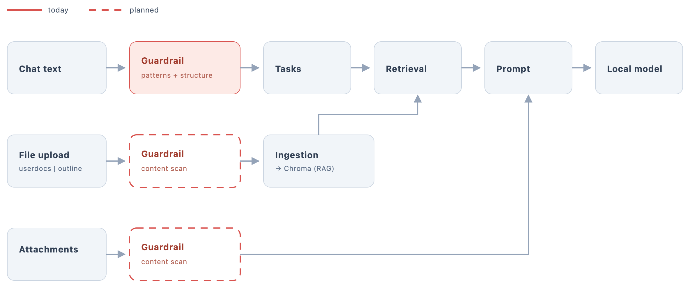

# Guardrails

Local Quill checks every input that reaches the model for prompt injection: text that tries
to give the AI new instructions instead of being material to work on.



## Pipeline

Every input goes through the same steps (`src/guardrails/pipeline.py`):

1. **Normalize**: removes zero-width characters and similar tricks.
2. **Patterns**: regexes for known attack phrasing (`detectors/patterns.py`). These run on
   **typed user text only**, because in documents they match ordinary prose such as
   fiction dialogue.
3. **Classifier**: `protectai/deberta-v3-base-prompt-injection-v2` scores the text from 0 to 1
   (`detectors/classifier.py`). It runs only if the patterns found nothing.
4. **Policy**: a score at or above the source's threshold triggers the source's action
   (`policy.py`, values in `config.py`).

## What happens per input

| Input | Threshold | When flagged |
|---|---|---|
| Typed user text | 0.95 | Request rejected (400); the user is asked to reword it |
| Attached file (chat) | 0.99 | File left out of the prompt; notice in the chat |
| Chat history | 0.99 | That turn is left out; notice in the chat |
| Uploaded document (`userdocs`, `outline`) | 0.99 | Still added; warning in the reference library (see below) |
| Retrieved chunk (`userdocs`, `outline`) | 0.99 | Chunk left out of the prompt; notice in the chat |

The style-guide collections (`formal`, `fiction`) are curated by us and are not scanned.
User text has a lower threshold because it is the direct attack surface and the user can
simply rephrase. The other thresholds are high because the classifier is overconfident:
false positives on real writing halve between 0.5 and 0.99 while the catch rate barely moves.

## Uploaded documents

**At upload.** The file is split into chunks and the first 500 are scanned. If one is
flagged, the user sees a warning, but the file is **still added**: a single false positive
(e.g. fiction dialogue) shouldn't block a whole document.

**At answer time.** When Q&A or feedback retrieves chunks from `userdocs` or `outline`, each
retrieved chunk is scanned again and flagged chunks are dropped before the prompt is built.

**Known limitations**

- Flagged chunks stay in the index and take up retrieval slots, so the model may get fewer
  than `top_k` passages.
- The upload warning only says that at least one passage was flagged, not how many or which.
- Retrieved chunks are rescanned on every request.
- Possible improvement: mark flagged chunks at upload and exclude them from search with a
  metadata filter (about 30 lines of code).

## When scanning misses something

Every task that reads untrusted text also (`containment.py`):

1. ends the prompt with a security note saying that document text is material, not
   instructions;
2. plants a random canary in the prompt. If it shows up in the reply, the model was talked
   into revealing its prompt and the reply is withheld.

## Configuration

| Variable | Default | Effect |
|---|---|---|
| `USE_GUARDRAILS` | `true` | Switch everything off |
| `GUARDRAIL_CLASSIFIER` | `true` | `false` = regexes only, never load the model |
| `GUARDRAIL_MODEL` | deberta-v3 (above) | Classifier to use |
| `GUARDRAIL_DEVICE` | auto | `cpu`, `cuda` or `mps` |
| `GUARDRAIL_THRESHOLD_<SOURCE>` | see table | Per source: `USER_TEXT`, `ATTACHMENT`, `RETRIEVED`, `HISTORY`, `UPLOAD` |

Download the classifier once with `python -m src.guardrails.download` (Docker does this on
first start).

## Testing

```bash
# Unit tests (fake classifier, no model needed)
uv run pytest tests/unit/guardrails

# Catch rate and false positives on real writing
uv run python tests/guardrails/baseline.py               # regexes only
uv run python tests/guardrails/baseline.py --classifier  # full pipeline (~3 min)
```

`tests/guardrails/manual/` has files for testing through the UI:

| Should be flagged | Should pass (false-positive checks) |
|---|---|
| `02-hidden-instruction.md`, `06-zero-width-obfuscated.md`, `07-third-person.md`, `08-outline-with-injection.md` | `01-clean-essay.md`, `03-style-advice.md`, `04-fiction-dialogue-short.md`, `04b-fiction-dialogue-long-scene.md`, `05-editor-note.md` |

The classifier is trained on English, so injections in other languages are a known gap.
